

  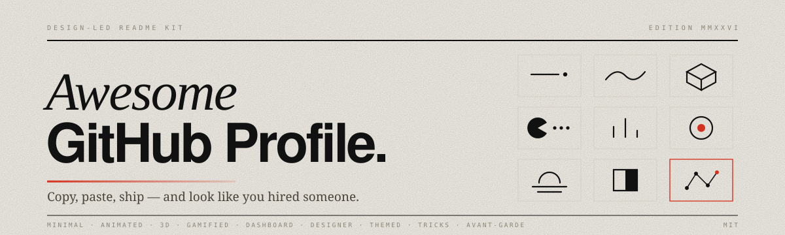

<h1 align="center">Awesome GitHub Profile</h1>

  <strong>Design-led GitHub profile README templates.</strong> 
  From minimal type studies to 3D contribution skylines — copy, paste, ship.

<!-- BEGIN:badges -->

  
  
  
  

<!-- END:badges -->

---

## Why this exists

Every other "awesome profile README" project does one of three things: links to other people's profiles for inspiration, generates generic markdown from a form, or piles up unstyled examples that all look the same. **This one ships ready-to-paste, design-led templates** — every one held to a senior frontend bar, and every claim on this page checked by CI rather than by hand.

The last category — **[Avant-Garde](#09--avant-garde--showcase-tier)** — is the showcase tier. Multi-layer `feTurbulence` + `feDisplacementMap` for living aurora flow. Animated iridescent gradients with diagonal sheen sweeps for trading-card foil. SVG path morphing through topologically-equivalent geometric forms. Network graphs with nine simultaneous signal pulses driven by `<animateMotion>`. These push the GitHub README format to its actual limits — everything still pure SVG, no script, no GIF.

You shouldn't have to be a designer to look like one on GitHub.

## How to use

1. **Browse the [categories](#categories)** below and pick a template that matches your tone.
2. **Open the template's folder** — every template has its own README with a copy-and-customize block.
3. **Replace the `{{placeholders}}`** (each template lists exactly which ones it uses) and paste into your `<your-username>/<your-username>` profile repo's `README.md`.

### Know what you're getting

Templates are not all the same shape, and the gallery says which is which on every card. Check the kind before you pick:

<!-- BEGIN:kinds -->
| Kind | What you get |
|------|--------------|
| `svg` | ships a self-hosted SVG you download and commit |
| `markdown` | pure markdown — no images at all |
| `action` | a GitHub Action generates it in your repo |
| `technique` | a pattern you apply inside another template |
<!-- END:kinds -->

`svg` templates are the self-contained ones: you commit a single file to your own repo and nothing can rate-limit or 404 on you. `action` templates regenerate themselves on a schedule and need a one-time workflow — each template's README carries the exact YAML.

---

## Categories

<!-- BEGIN:gallery -->
### 01 · Minimal

> Less is more. Templates that earn attention through restraint.

<table border="0">
  <tr>
    <td width="50%" align="center" valign="top">
      <a href="./templates/01-minimal/editorial-card/">
        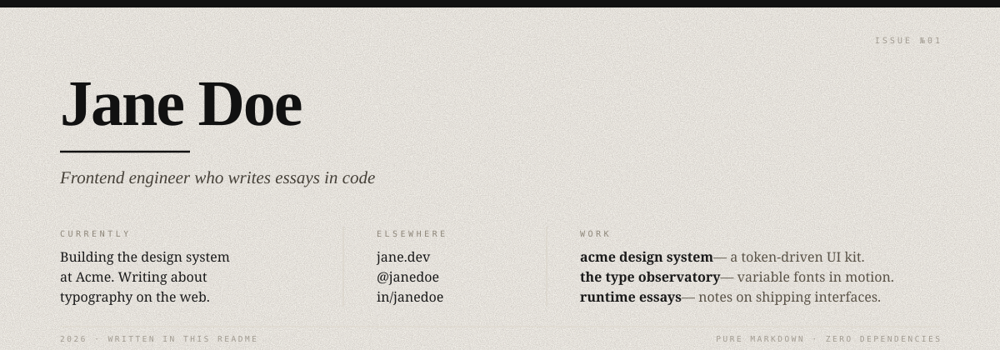
         <strong>Editorial Card</strong>
      </a>
       <code>markdown</code> · Basic
       Magazine-style serif. No deps.
    </td>
    <td width="50%" align="center" valign="top">
      <a href="./templates/01-minimal/monospace-cv/">
        
         <strong>Monospace CV</strong>
      </a>
       <code>markdown</code> · Basic
       Profile as a terminal session.
    </td>
  </tr>
</table>

### 02 · Animated

> One focal motion done well — never a carnival.

<table border="0">
  <tr>
    <td width="50%" align="center" valign="top">
      <a href="./templates/02-animated/neon-pulse-banner/">
        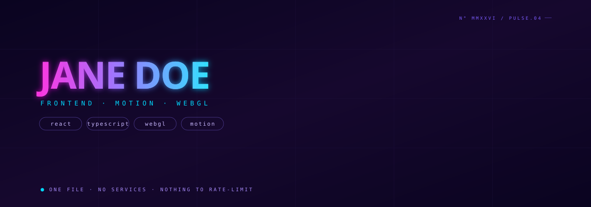
         <strong>Neon Pulse Banner</strong>
      </a>
       <code>svg</code> · Intermediate
       Wide gradient hero with a slow wave.
    </td>
    <td width="50%" align="center" valign="top">
      <a href="./templates/02-animated/typewriter-intro/">
        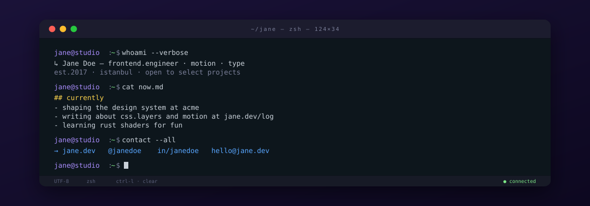
         <strong>Typewriter Intro</strong>
      </a>
       <code>svg</code> · Basic
       A terminal that types itself in.
    </td>
  </tr>
</table>

### 03 · 3D & Immersive

> Depth, perspective, motion that hints at WebGL — running entirely on `<svg>`.

<table border="0">
  <tr>
    <td width="50%" align="center" valign="top">
      <a href="./templates/03-3d-immersive/3d-contribution-tower/">
        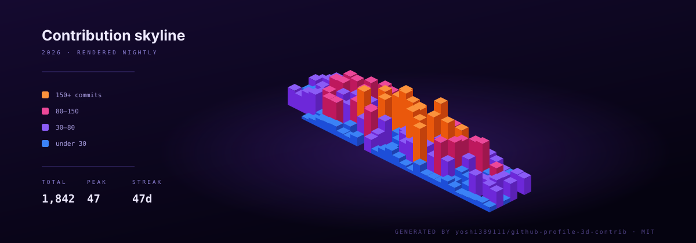
         <strong>3D Contribution Tower</strong>
      </a>
       <code>action</code> · Advanced
       Your contributions as an isometric skyline.
    </td>
    <td width="50%" align="center" valign="top">
      <a href="./templates/03-3d-immersive/tech-sphere/">
        
         <strong>Tech Sphere</strong>
      </a>
       <code>svg</code> · Advanced
       A rotating orbit of your stack.
    </td>
  </tr>
</table>

### 04 · Gamified

> Arcade-grade. Auto-updated by GitHub Actions.

<table border="0">
  <tr>
    <td width="50%" align="center" valign="top">
      <a href="./templates/04-gamified/snake-eat-graph/">
        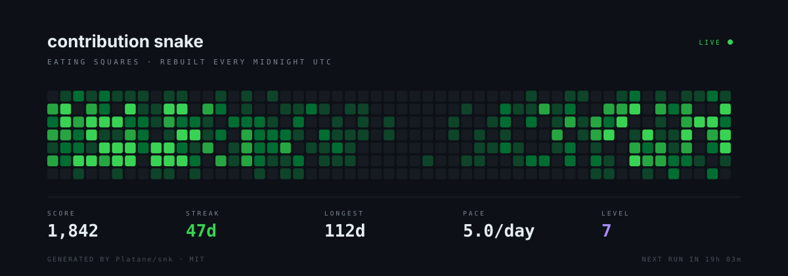
         <strong>Snake Eat Graph</strong>
      </a>
       <code>action</code> · Intermediate
       The classic. Eats your contributions daily.
    </td>
    <td width="50%" align="center" valign="top">
      <a href="./templates/04-gamified/pacman-graph/">
        
         <strong>Pac-Man Graph</strong>
      </a>
       <code>action</code> · Intermediate
       The louder cousin. Ghosts included.
    </td>
  </tr>
</table>

### 05 · Dashboard

> Stats-heavy templates that read like product analytics pages.

<table border="0">
  <tr>
    <td width="50%" align="center" valign="top">
      <a href="./templates/05-dashboard/analytics-grid/">
        
         <strong>Analytics Grid</strong>
      </a>
       <code>svg</code> · Intermediate
       Metric cards with sparklines. Dashboard energy.
    </td>
    <td width="50%" align="center" valign="top">
      <a href="./templates/05-dashboard/activity-pulse/">
        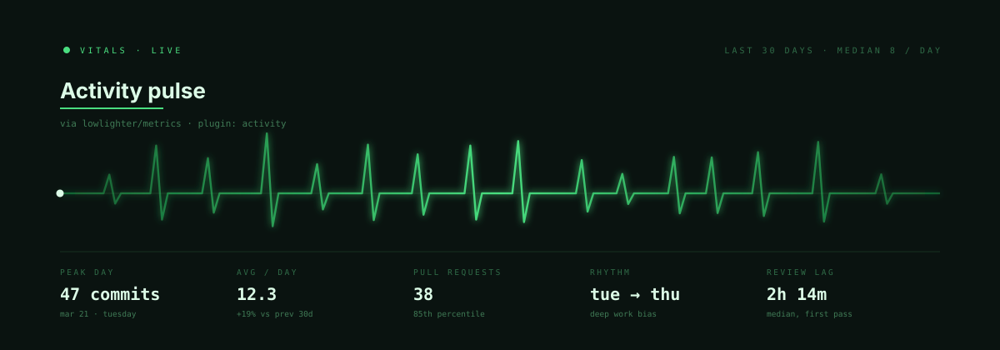
         <strong>Activity Pulse</strong>
      </a>
       <code>action</code> · Advanced
       One card. Lots of signal. metrics-engine.
    </td>
  </tr>
</table>

### 06 · Designer Portfolio

> Visual, brand-driven, opinionated. For people whose work is the way it looks.

<table border="0">
  <tr>
    <td width="50%" align="center" valign="top">
      <a href="./templates/06-designer-portfolio/glassmorphism-hero/">
        
         <strong>Glassmorphism Hero</strong>
      </a>
       <code>svg</code> · Advanced
       Frosted glass on a melting gradient.
    </td>
    <td width="50%" align="center" valign="top">
      <a href="./templates/06-designer-portfolio/editorial-magazine/">
        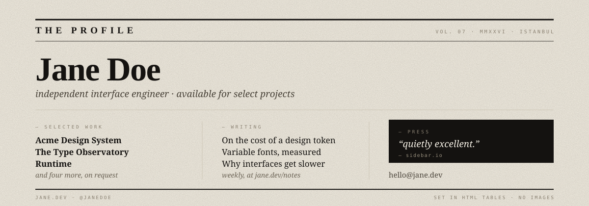
         <strong>Editorial Magazine</strong>
      </a>
       <code>markdown</code> · Intermediate
       Typeset like a small print quarterly.
    </td>
  </tr>
</table>

### 07 · Themed

> Strong aesthetic identity. Pick one and commit.

<table border="0">
  <tr>
    <td width="50%" align="center" valign="top">
      <a href="./templates/07-themed/cyberpunk-neon/">
        
         <strong>Cyberpunk Neon</strong>
      </a>
       <code>svg</code> · Advanced
       Vaporwave grid + chromatic aberration.
    </td>
    <td width="50%" align="center" valign="top">
      <a href="./templates/07-themed/dark-elegant/">
        
         <strong>Dark Elegant</strong>
      </a>
       <code>svg</code> · Intermediate
       Monogram, gold hairline, restraint.
    </td>
  </tr>
</table>

### 08 · Markdown Tricks

> Techniques that make every other template better. Use them inside whichever you pick.

<table border="0">
  <tr>
    <td width="50%" align="center" valign="top">
      <a href="./templates/08-markdown-tricks/light-dark-switcher/">
        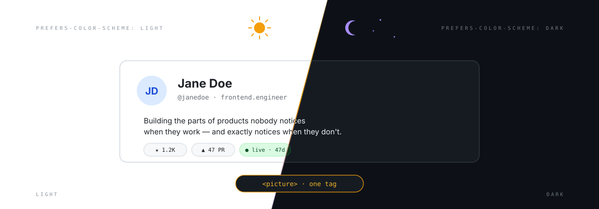
         <strong>Light / Dark Switcher</strong>
      </a>
       <code>technique</code> · Basic
       One picture tag, perfect theme parity.
    </td>
    <td width="50%" align="center" valign="top">
      <a href="./templates/08-markdown-tricks/collapsible-projects/">
        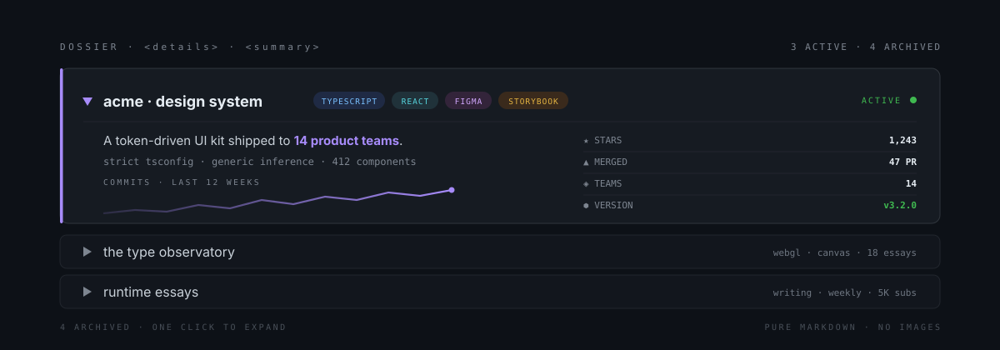
         <strong>Collapsible Projects</strong>
      </a>
       <code>markdown</code> · Basic
       Pack ten projects into the space of three.
    </td>
  </tr>
</table>

### 09 · Avant-Garde — showcase tier

> What the GitHub README format is *actually* capable of when you push every SVG primitive at once. No scripts, no GIFs, no external services — just SMIL animation, filter primitives, path morphing, and motion paths, composed with intent.

<table border="0">
  <tr>
    <td width="50%" align="center" valign="top">
      <a href="./templates/09-avant-garde/aurora-veil/">
        
         <strong>Aurora Veil</strong>
      </a>
       <code>svg</code> · Advanced
       Multi-layer turbulence + displacement, never repeats.
    </td>
    <td width="50%" align="center" valign="top">
      <a href="./templates/09-avant-garde/holographic-foil/">
        
         <strong>Holographic Foil</strong>
      </a>
       <code>svg</code> · Advanced
       Trading-card foil, animated stop-color iridescence.
    </td>
  </tr>
  <tr>
    <td width="50%" align="center" valign="top">
      <a href="./templates/09-avant-garde/liquid-morph-wordmark/">
        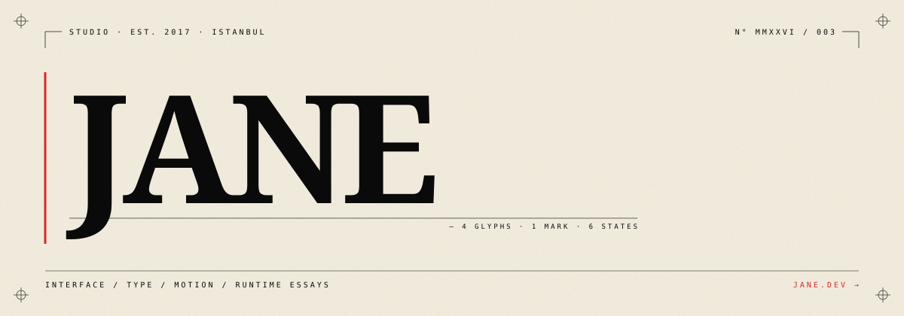
         <strong>Liquid Morph Wordmark</strong>
      </a>
       <code>svg</code> · Advanced
       Path interpolation across six geometric forms.
    </td>
    <td width="50%" align="center" valign="top">
      <a href="./templates/09-avant-garde/neural-pulse-lattice/">
        
         <strong>Neural Pulse Lattice</strong>
      </a>
       <code>svg</code> · Advanced
       10 nodes, 15 edges, 9 signals — animateMotion + mpath.
    </td>
  </tr>
</table>
<!-- END:gallery -->

---

## Full template index

<!-- BEGIN:index -->
| #  | Template | Category | Kind | Difficulty | External services |
|----|----------|----------|------|------------|-------------------|
| 01 | [Editorial Card](./templates/01-minimal/editorial-card/) | Minimal | `markdown` | Basic | none |
| 02 | [Monospace CV](./templates/01-minimal/monospace-cv/) | Minimal | `markdown` | Basic | `readme-typing-svg.demolab.com` *(optional)* |
| 03 | [Neon Pulse Banner](./templates/02-animated/neon-pulse-banner/) | Animated | `svg` | Intermediate | none |
| 04 | [Typewriter Intro](./templates/02-animated/typewriter-intro/) | Animated | `svg` | Basic | none |
| 05 | [3D Contribution Tower](./templates/03-3d-immersive/3d-contribution-tower/) | 3D & Immersive | `action` | Advanced | none |
| 06 | [Tech Sphere](./templates/03-3d-immersive/tech-sphere/) | 3D & Immersive | `svg` | Advanced | none |
| 07 | [Snake Eat Graph](./templates/04-gamified/snake-eat-graph/) | Gamified | `action` | Intermediate | `raw.githubusercontent.com` |
| 08 | [Pac-Man Graph](./templates/04-gamified/pacman-graph/) | Gamified | `action` | Intermediate | `raw.githubusercontent.com` |
| 09 | [Analytics Grid](./templates/05-dashboard/analytics-grid/) | Dashboard | `svg` | Intermediate | `github-readme-stats.vercel.app` *(optional)* |
| 10 | [Activity Pulse](./templates/05-dashboard/activity-pulse/) | Dashboard | `action` | Advanced | none |
| 11 | [Glassmorphism Hero](./templates/06-designer-portfolio/glassmorphism-hero/) | Designer Portfolio | `svg` | Advanced | none |
| 12 | [Editorial Magazine](./templates/06-designer-portfolio/editorial-magazine/) | Designer Portfolio | `markdown` | Intermediate | none |
| 13 | [Cyberpunk Neon](./templates/07-themed/cyberpunk-neon/) | Themed | `svg` | Advanced | none |
| 14 | [Dark Elegant](./templates/07-themed/dark-elegant/) | Themed | `svg` | Intermediate | `github-readme-stats.vercel.app` *(optional)* |
| 15 | [Light / Dark Switcher](./templates/08-markdown-tricks/light-dark-switcher/) | Markdown Tricks | `technique` | Basic | `github-readme-stats.vercel.app` *(optional)* `raw.githubusercontent.com` *(optional)* |
| 16 | [Collapsible Projects](./templates/08-markdown-tricks/collapsible-projects/) | Markdown Tricks | `markdown` | Basic | none |
| 17 | [Aurora Veil](./templates/09-avant-garde/aurora-veil/) | Avant-Garde | `svg` | Advanced | none |
| 18 | [Holographic Foil](./templates/09-avant-garde/holographic-foil/) | Avant-Garde | `svg` | Advanced | none |
| 19 | [Liquid Morph Wordmark](./templates/09-avant-garde/liquid-morph-wordmark/) | Avant-Garde | `svg` | Advanced | none |
| 20 | [Neural Pulse Lattice](./templates/09-avant-garde/neural-pulse-lattice/) | Avant-Garde | `svg` | Advanced | none |
<!-- END:index -->

---

## How this differs from other lists

|                                       | This repo | [awesome-github-profile-readme](https://github.com/abhisheknaiidu/awesome-github-profile-readme) | [awesome-github-profile-readme-templates](https://github.com/durgeshsamariya/awesome-github-profile-readme-templates) | [Profilinator](https://profilinator.rishav.dev/) / [GPRM](https://gprm.itsvg.in/) |
|---------------------------------------|:---------:|:---------:|:---------:|:---------:|
| Ready-to-paste markdown               | ✅        | ❌         | ✅         | ✅         |
| Design-led, opinionated templates     | ✅        | ❌         | ⚠️         | ❌         |
| Boundary-pushing SVG (turbulence, path morph, animateMotion) | ✅ | ❌ | ❌ | ❌ |
| 3D / immersive templates              | ✅        | ⚠️         | ❌         | ❌         |
| GitHub Action setup walkthroughs      | ✅        | ❌         | ❌         | ❌         |
| Dependency count stated per template  | ✅        | ❌         | ❌         | ❌         |
| Quality bar enforced by CI, not honour system | ✅ | ❌     | ❌         | n/a       |

`✅ yes  · ⚠️ partial · ❌ no`

---

## Contributing

Adding a new template? Read [`CONTRIBUTING.md`](CONTRIBUTING.md) — it documents the quality bar, the `meta.json` contract, and the PR process. The bar is not a checklist someone eyeballs: `npm run check` enforces it, and CI runs it on every pull request.

If you found a bug (broken link, wrong placeholder, render glitch on mobile), open an issue or PR with a screenshot.

## Credits

This repo stands on the shoulders of the public services that make GitHub READMEs expressive. The list below is generated from what the templates actually depend on, so it can't drift into thanking something nothing uses:

<!-- BEGIN:credits -->
- [abozanona](https://github.com/abozanona) — [pacman-contribution-graph](https://github.com/abozanona/pacman-contribution-graph)
- [anuraghazra](https://github.com/anuraghazra) — [github-readme-stats](https://github.com/anuraghazra/github-readme-stats)
- [crazy-max](https://github.com/crazy-max) — [ghaction-github-pages](https://github.com/crazy-max/ghaction-github-pages)
- [DenverCoder1](https://github.com/DenverCoder1) — [readme-typing-svg](https://github.com/DenverCoder1/readme-typing-svg)
- [lowlighter](https://github.com/lowlighter) — [metrics](https://github.com/lowlighter/metrics)
- [Platane](https://github.com/Platane) — [snk](https://github.com/Platane/snk)
- [yoshi389111](https://github.com/yoshi389111) — [github-profile-3d-contrib](https://github.com/yoshi389111/github-profile-3d-contrib)
<!-- END:credits -->

If your project is referenced and you'd like a different attribution wording, open an issue.

## License

[MIT](LICENSE) — use these templates anywhere, no attribution required (but appreciated).
